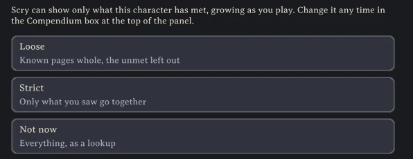
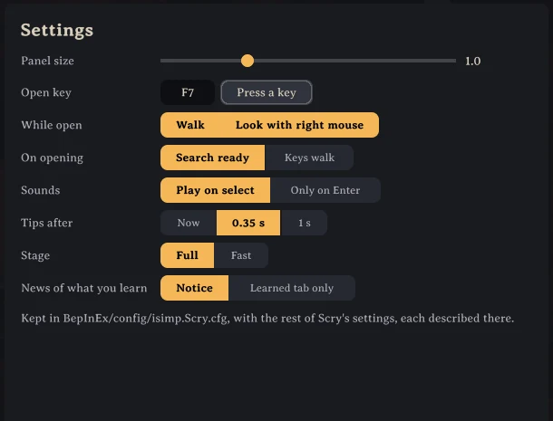

# Installing Scry

## Playing

Install Scry from a mod manager, or put `Scry.dll` in `BepInEx/plugins`. Press F7 or type `/scry` in the chat to open it; the other commands are in [commands](commands.md). Scry spawns nothing, saves nothing into the world and shows nothing to other players, so it works on any server whether the server has it or not.

A new character starts with the compendium off, and Scry is then a lookup of everything in the game. The first time the panel opens for it, Scry asks whether to keep a compendium: *Loose*, *Strict* or *Not now* ([the compendium's rules](rules.md)). The choice can be changed any time under *Compendium* at the top of the panel. Each character keeps its own choice and its own knowledge.

The gear beside *Compendium* holds the panel's settings: its size, the key opening it, walking and looking while it is open, sounds, tips, the dungeon marks on the large map, and *Stage* set to *Fast* for a big dungeon on a weaker machine. They are kept in `BepInEx/config/isimp.Scry.cfg` with the rest, which a mod manager's config editor shows too.

## Playing with friends

Every player should run the same version of Scry. Where a friend's game has Scry, what happens around you in their game (a kill, a drop, a pick) counts for you as it would alone. What runs in a game without Scry reaches you only as your own game sees it, a creature's death by its remains and your own pick; the rest goes unlearned. *Who has Scry* in the compendium's box lists everyone you play with and whether their game has it.

## On a dedicated server

The server does not need Scry, but with it the compendium learns what only the server knows: which places lie in the ground you explored or got from a shared map, how many of each place the world holds, and which dungeons anyone on the server walked, from their walks and from what was left inside the dungeons before Scry was there. The server can also set the compendium's rules for everyone ([server settings](server-settings.md)).

Put the same Scry package in the server's `BepInEx/plugins`, by the server profile of a mod manager or by copying `Scry.dll`. On its first start the server writes `BepInEx/config/isimp.Scry.cfg` with a section *4 - World*; left as it is, every choice stays each player's. Restart the server after changing it.

## Hosting from the game

A game hosting a world is that world's server: the host's own Scry does the server's part, and nothing more needs installing. One thing differs from a dedicated server: the host's own *4 - World* settings bind everyone who joins, so a host who changed them for themselves changed them for their friends too. The traces left inside the world's dungeons are read at each start as a dedicated server reads them, a few milliseconds a frame while the host plays.

## Moving a world

The server keeps the records of the dungeons walked in `BepInEx/cache/isimp.Scry/maps-<world>.dat` beside its own files. A world moved from a hosting game to a dedicated server, or between servers, takes its records along only when that file is copied with it.

More: https://github.com/isimp/Scry
