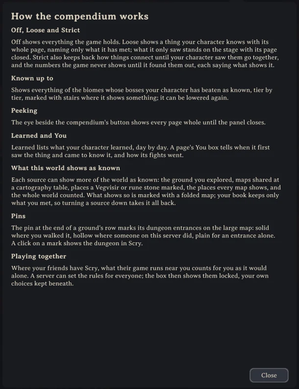
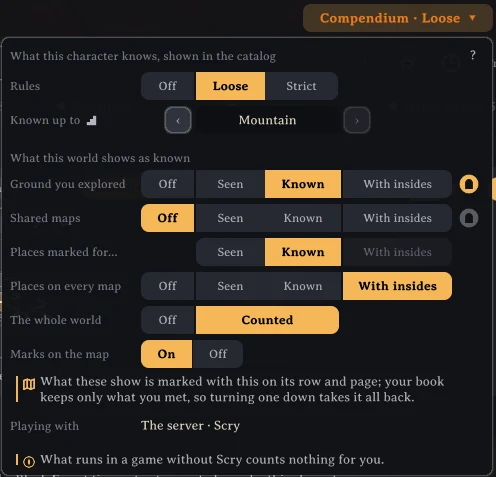

# The compendium's rules

The compendium shows only what the character you play has come to know, and grows as you play. It is chosen for each character in the *Compendium* box at the top of the panel, and a character whose compendium is off is asked once whether to keep one. The *?* in that box tells the same as this page, in the game.

## Off, Loose and Strict

*Off* shows everything the game holds, as a lookup.

*Loose* shows a thing you know with its whole page, but names only what your character has met: a creature once fought, an item once held or made, a place once stepped into. The rest of a page is left out, its loot and where it lives saying how many more are not yet met, and a name never met reads ??? in a page's text. What you have only seen stands on the stage with its page closed, saying how to come to know it.

*Strict* also keeps back how things connect until your character saw them go together: the drops it saw fall, where it met a creature, what it made at a station. Numbers the game never shows wait until you found them out: an attack's damage until it hit you, a creature's health until you killed one, a tree's health until you broke one. Each says what shows it, and a page's title row counts how much of it was found out, "7 of 12 found out", its hover listing what is left; where *Known up to* shows a page whole, the row says so. Drops show what your character saw fall and how often, not the game's chances.

## Known up to, peeking and Learned

*Known up to* shows everything of the biomes whose bosses your character has beaten as known, tier by tier, marked with stairs wherever it shows something, and can be lowered again.

The eye beside the compendium's button peeks at the page shown: it shows whole until you go to another, and its notice's *Every page* shows every page whole until the panel closes.

*Learned* lists what your character learned, newest first, day by day, under *Strict* also the numbers it found out, which *Loose* shows from the start (in the search, `is:new` finds what it learned today, `is:seen` what it has only seen, `is:walked` the dungeons it walked, and under *Strict* `is:left` what still has a number to find out by a deed, a kill, a taming, a birth), and a page's *You* box tells when it first saw the thing and came to know it, in what weather and with what in hand, and how its kills went. A row of *Learned* opens its page at what changed, the line telling it lit a moment.

## What a world shows as known

The compendium's box also chooses what the world itself may show as known, source by source. *Ground you explored* and *Places marked for you* (a Vegvisir or a rune stone) start at *Seen*; *Shared maps* (a cartography table), *Places on every map* (traders, the start, Hildir's places) and *The whole world* start off. Each can be raised to *Known*, or *With insides* to show the dungeons in it with whatever anyone on the server walked inside them; *The whole world* is *Counted*, making every kind of place the world holds heard of. What shows so is marked with a folded map, and your book keeps only what you met yourself, so turning a source down takes it all back. Your map reaches 100 m around you whatever you saw, so *Ground you explored* can also be turned off, leaving only the places you saw, and so can *Places marked for you*, which you never looked at either.

The pin at the end of *Ground you explored* and *Shared maps* marks every dungeon entrance lying in that ground on Valheim's large map: solid where you walked it, ticked where every room of it was walked, by you alone or by you and others on the server together, hollow where only others did, ticked in outline once they walked it all, plain for an entrance alone. A mark you walked and its page's line count the rooms others on the server walked whatever the compendium shows: "Walked whole on this server: all 9 rooms, 5 of them by you". A click on a mark shows that dungeon in Scry. *Marks on the map*, under the pins, turns every mark of Scry's on the map on or off.

## Playing together

Where your friends have Scry, what their game runs near you, a kill or a drop or a pick, counts for you as it would alone, if you did it or saw it, within 30 m with nothing solid between, as a wall or a hill hides a place. What runs in a game without Scry counts nothing, and a notice names those players.

A server can set the rules for everyone and cap each source ([server settings](server-settings.md)); the box then shows the server's choice locked, your own kept beneath it.

More: https://github.com/isimp/Scry
