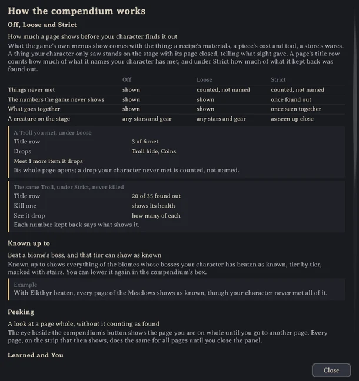
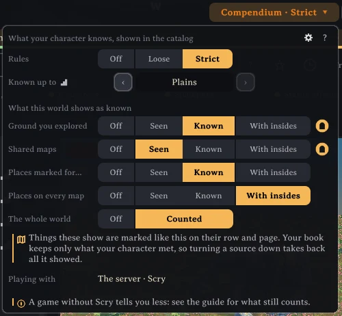
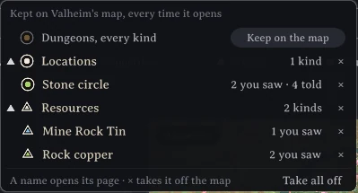
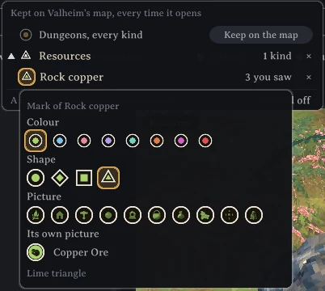
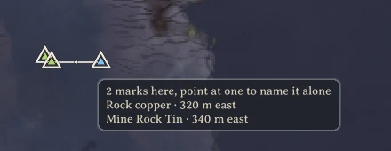
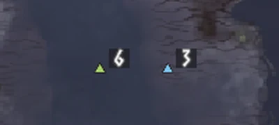
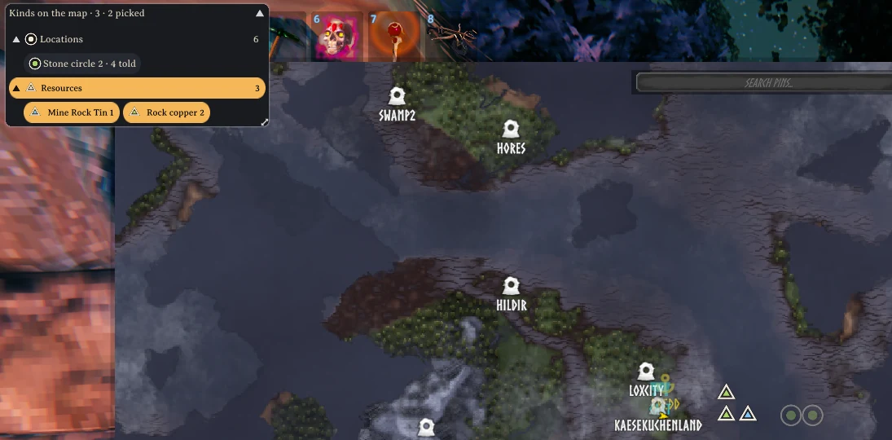

# The compendium's rules

The compendium shows only what the character you play has come to know, and grows as you play. It is chosen for each character in the box a click on the *Compendium* button at the top of the panel opens, or in the settings' *Compendium* section, which holds the same rows, and a character whose compendium is off is asked once whether to keep one. The *?* in that box tells these rules in short, in the game.

## Off, Loose and Strict

*Off* shows everything the game holds, as a lookup.

*Loose* shows a thing you know with its whole page, but names only what your character has met, seen once or known: a creature once seen or fought, an item once seen, held or made, a place once seen or stepped into. What the game's own menus show comes with the thing, once the game lists it for your character (a recipe once its station and every material are known; until then its row waits, under either rules): a recipe's materials and station, a piece's cost and tool, what a known thing is made into, a station's recipes, a store's wares, as the game shows them the moment the thing is known. The rest of a page is left out, every section saying how many more are not yet met, as a dungeon room's card and a raid's card do, and a name never met reads as a dash in a page's text. A page's title row counts how much of what it names was met, "3 of 6 met", its hover and the *You* box saying how many are still to meet first, lit as *All met* once nothing is left out. A place's runestone texts show once you read each, under either rules, and each counts in its title row until read. What you have only seen stands on the stage with its page closed, telling what sight gave, the stars and gear it was seen with up close and where it was seen, and how to come to know it; its row in the list is faint, noted seen.

*Strict* also keeps back what the game never shows of how things connect until your character saw them go together, each the way the row tells it: a creature's drops once seen to fall from it, not merely seen beside it; where it met a creature; what a chest held. A chest you or a friend filled pairs nothing with its place. Numbers the game never shows wait until you found them out: an attack's damage, reach and pace until it hit you, how a creature sees, hears, chases and flees until you fought one, how a burn, a poison or frost works on you until you had it, a trap's damage until you saw one spring, what a raid brings until you saw those raiders up close and how often it is rolled until you saw any, a place's spawn stars until you saw one of its creatures up close there, how a fish fights with so many stars until you landed one with them or saw one landed near by, how a piece takes each damage until your hits on one showed it, a creature's health until you killed one of that very kind or saw one killed up close (kills from before Scry count for every creature going by its name), a tree's health until you broke one or saw one broken, what one star changes until one with one star was seen to fall. A creature born tame, as a hen or a summon, has no taming to find out; how long its meal lasts shows once you saw one eat, and a summon's health is not kept back, as nothing but slaughtering your own would show it. Each says what shows it, and a page's title row counts how much of what it keeps back was found out, each number, counted cell, line of where an item comes from and name not yet seen together one, "7 of 12 found out", its hover listing what is left, lit as *All found out* only once nothing is kept back; each section ends saying how many it left out; where *Known up to* shows a page whole, the row says so. What *Strict* keeps back shows as a soft smudge where the value would stand, its hover saying what frees it; an attack's animations wait as one chip counting them.

Up close is within 10 m, as far as the game names a creature and marks its stars; an item, a piece or a resource is seen only there, by its nearest part, while a creature is seen as far as its size makes it out, its stars and gear only up close; a server can set another reach. Under *Strict* the stage shows a creature only with the stars it was seen with up close and only carrying what it was seen carrying, what its set puts on with something seen of it (a Dvergr mage's staff with its robe), or saw it attack with; a place's example and a raid stand their creatures no higher, and the *You* box lists the star levels and gear the stage still lacks, counted in its chip. What a starred creature's fall shows of its stars waits until you saw those stars up close, at the death or before; a kill credited from afar counts the fall and its loot alone. A creature's attack begun up close, a boss's as much farther as the game shows its health bar, and any as far as its creature uses it from (a taunt or a spit from 20 m), in view, counts as seen, two attacks that start alike told apart by the weapon the creature holds or by what the attack makes beside it, as a Dvergr mage's shield and its Mistiles: its damage, and its animations, which *Strict* keeps back with it, show from then on, as after taking the hit.

Drops show what your character saw fall and how often, not the game's chances, the row's title counting the kills whose loot it saw fall and its hover setting them against the game's own count of your kills; a trophy's chance by stars as your own count at those stars. Your own hits tell how a damage type lands where you saw its popup, within 30 m, on whichever game the creature runs; another player's hit tells nothing, as the game shows you only a number. Riding a creature shows its health, as the game prints it for the one ridden. The search finds a known thing only by what its page shows, and `is:left` finds the pages whose title chip still counts something to find out. Peeking shows a page whole and hides nothing your book knows: the list's rows, *Learned*'s days and the *You* box's own lines stay.

## Known up to, peeking and Learned

*Known up to* shows everything of the biomes whose bosses your character has beaten as known, tier by tier, marked with stairs wherever it shows something, and can be lowered again.

The eye beside the compendium's button peeks at the page shown: it shows whole until you go to another, a step back or forward to a page you left peeked at peeking at it again until the peek is stopped, and its notice's *Every page* shows every page whole until the panel closes.

*Learned* lists what your character learned, newest first, day by day, under *Strict* also the numbers it found out, which *Loose* shows from the start (in the search, `is:new` finds what it learned today, `is:seen` what it has only seen, `is:walked` the dungeons it walked, and `is:left` the pages whose title chip still counts something to find out or meet), and a page's *You* box tells when it first saw the thing and came to know it, in what weather and with what in hand, and how its kills went. A row of *Learned* opens its page at what changed, the line telling it lit a moment.

## What a world shows as known

The compendium's box also chooses what the world itself may show as known, source by source. *Ground you explored* and *Places marked for you* (a Vegvisir or a rune stone) start at *Seen*; *Shared maps* (a cartography table), *Places on every map* (traders, the start, Hildir's places) and *The whole world* start off. Each can be raised to *Known*, or *With insides* to show the dungeons in it with whatever anyone on the server walked inside them; *The whole world* is *Counted*, making every kind of place the world holds heard of. What shows so is marked with a folded map, and your book keeps only what you met yourself, so turning a source down takes it all back. Your map reaches 100 m around you whatever you saw, so *Ground you explored* can also be turned off, leaving only the places and biomes you saw, and so can *Places marked for you*, which you never looked at either. The biomes under your explored ground show seen the same way, never more whatever the source is raised to, and go with the source.

## On the map

Valheim's large map marks each dungeon where *Show on map* would show its place: one you walked, and one whose entrance your character saw; solid where you walked it, ticked where every room of it was walked, by you alone or by you and others on the server together, hollow where only others did and *Ground you explored* shows *With insides*, ticked in outline once they walked it all; faint for an entrance alone, or where insides are not shown, until the pointer rests on it. Each mark carries a glyph for the dungeon's kind and stands on its entrance. A mark, as each of *Show on map*'s dots, stands only where your map shows the ground, explored by you or on a map shared with you: an entrance your character saw from farther than the map explores around you waits until you explore there. A mark you walked and its page's line count the rooms others on the server walked whatever the compendium shows: "Walked whole on this server: all 9 rooms, 5 of them by you". *Open its page* in a mark's menu shows that dungeon in Scry.

A dungeon lying in ground you never came near gets no mark of its own: its page's *Show on map* shades the square it lies in.

The dungeons stand on the map while kept in the title row's *On the map* list, from the start; any kind a page shows with *Show on map* can be kept there too, with *Keep on the map* on its page or on the map's strip, its dots standing every time the map opens and its squares with them; a dungeon kept with every kind of dungeon, or a kind kept with its place's others, shows its page's button lit, saying by which line. A page of several kinds, a place's numbered kinds or resources the game names alike when you look at them, as the ribs and the skull of Petrified Bone, offers two more buttons named for how many there are, one showing them all on the map at once and one keeping them as one line, which takes their own lines off and keeps the mark they stood in; each one's tip names the kinds, and the map's strip switches between the page's kind and all of them. The list stands what is kept under a heading for each category, dungeons, locations and resources; a heading's arrow folds it and its × takes the whole category off the map, and what stands folded is kept with the panel's place. Under each, the list counts how many of a kind stand, a name opens its page, × takes it off the map and *Take all off* empties it. Every kind of dungeon kept is the dungeons' heading, its types listed under it with how many, a click on one opening its page; taken off, it stays at the top, faint, with *Keep on the map* to put it back. More lines than fit under the button scroll, by the wheel or the thumb at its right edge.

A place the game's map marks itself, by its own icon or by a pin a Vegvisir set, and a dungeon you walked, marked as walked, get no square, as their marks show exactly where they stand; a square holding more than one counts them on a tab in its corner, or, drawn too small for the tab as the map zooms out, shows a pip across its middle for each, up to four (`MarkStacks.SquarePips`).

Each kind on the map stands in a mark of its own, kept with it while it is kept: a location a circle and a resource a triangle, each kind one of eight colours, so eight of a category are told apart before a colour repeats; a book kept before this has its plain marks moved to their category's shape once, in their colour where it is free; the list and the strip show each kind's mark beside its name. A click on a kind's mark in the list, or on the mark that stands beside *Keep on the map* on its page and on the map's strip once it is kept, opens a small picker under it: any of the eight colours, in any of the four shapes, in one of the game's map pictures (fire, house, hammer, dot, portal, cauldron, bag, cart, stones, rune stone) drawn inside Scry's ring, or on the kind's own picture where it has one: an item's or a piece's icon, the first thing a deposit, bush or tree drops that has one, a creature's trophy; a place has none. The pick stands at once and is kept with the character; two kinds may share one look, the picker dotting the looks another kind stands in and naming it, and a kind kept anew still takes the first colour none stands in, in its category's shape. Every kind of dungeon keeps its amber discs. A square's tab shows a kind's own picture as its colour alone, too small to read. A square of one kind is hatched and edged in its colour, one holding several in white with each kind's mark on its tab.

A server set to tell where places stand (its *Places in explored ground* on *Dots*; playing alone or hosting, your own) shows them as hollow dots in their kind's mark instead of squares, the pointer saying the server told of it; *Told by the server* in the settings' *Map* section turns squares and hollow dots off for you. Every kind of dungeon keeps its amber.

Pointing at a dot on the map names its kind and how far it is; at a square, what stands somewhere inside. Dots so near on the map that they overlap by more than a third of their width show a small pip under them for each dot there, up to four, on the minimap too; pointing at them spreads them round their spot, a thin line from each to it, and names every kind there, nearest first, until the pointer leaves them, a dot pointed at in the spread named alone (`MarkStacks`, gathered by where the dots lie, again only as the map zooms). Zoomed in far enough they stand apart and their pips go.

*Far out* in the settings' *Map* section chooses how the marks stand on a crowded map: *Full marks*; *Full, merged by kind*, a kind's dots that would cover each other standing as its first one with how many on a dark tab beside it, before the kinds stack together; *Plain*, every mark, once a dot spans some 60 m of ground, as the middle of its own picture without the ring, smaller; or *Plain, merged by kind*, the first choice, both. Merging gathers each kind's own dots by the same overlap as the stacks, again only as the map zooms, a kind the server told of apart from the same kind seen (`MapLook.Merges`, `MapLook.PlainAt`). A merged mark pointed at names its kind, how many and the nearest; *Zoom in on them* in its menu zooms the map in on it, to a fifth, until its dots come apart. On the minimap a merged mark shows pips for how many it stands for, as it is too small for a count.

The *Kinds strip*, on at first, is a small list of the kinds standing on the map, at its top left under Show on map's strip until moved: kinds stand under their category, dungeons, locations and resources, a heading picking every kind under it and its arrow folding it; a family's kinds, as a place's numbered ones, stand under one chip, each chip with its mark and how many, a dungeon counted by its marks as well as what the server told of, and a kind not picked fades its dungeon marks and their names with its dots; its title row drags it anywhere on the screen, beside the map too, the arrow at its end folds it to the title, the corner at its foot sizes it both ways, a row at a time, past the rows it is tall enough for it scrolls, the wheel over it leaving the map's zoom alone, and where it stands, how big and whether folded are kept with the panel's place (`KindsList`); a press on it or on Show on map's strip is theirs, the map neither dragging nor counting a click from it (`Minimap.OnMapLeftDown`); a click on one picks it to stand out, the kinds not picked faded to a fifth, more picked standing out beside it, the picked kinds' dots standing over the game's pins too, and the counts of all with them, a faded kind's count faded with it, a click on a picked one letting it fade again and closing the map showing them all alike; a chip counts the ones you saw and those the server told of apart (`MapSpots.ShowAlone`). A heading picks every kind under it the same way, lit while all are picked and outlined while some are.

A merged mark of places the server told of carries its count on a hollow tab, as its dot is hollow. While the pointer rests on a merged mark, every other dot it stands for shows at its own spot in an accent ring, the mark pointed at ringed as any is. A stack spread out lays its dots round the middle of where they lie, each on the side it lies on, evenly apart (`MarkStacks.FanAngles`), a merged mark among them keeping its count and, pointed at, showing its other dots. A plain mark is drawn as the kind's shape and its edge alone, with nothing of the ring round it. A diamond's and a triangle's ring and edge stand as thick across their sides as a circle's (`SeenOnMap.DotAt`).

Scry's dots stand under the game's pins and their names, so a base's pins can hide them; *Marks over pins* in the settings' *Map* section brings them over: *Never*; *When pointed at*, the first choice, a dot or a spread stack while the pointer rests on it; or *Always*, every dot at all times. *Pips over pins*, on at first, keeps the pips over the pins whatever the dots do, so a stack under your pins still shows it holds several, on the minimap too. *Pins near the pointer* at *A third* fades the game's pins and names within reach of a pointed dot or spread stack while the pointer rests there, each by a group of its own laid on it, back to full as it leaves (`MapLook.PointedOver`, `MapLook.PipsOver`, `MarkStacks.FadeReach`); at *Full*, the first choice, they stay as they are.

A click on a dot or a dungeon's mark goes through its modes, as the game's own click crosses its pins, for that one spot alone: crossed off, the mark dimmed under the game's own cross; highlighted, bigger with an amber outline following its shape and over the game's pins at all times; then plain again. On a merged mark it takes every spot the mark stands for, and in a spread each dot its own. A click counts let go within half a dot of where it was pressed, so dragging the map is no click, and a double-click there adds no pin. The pointer's words say what the next click does.

A right click opens a small menu at the pointer, named for the mark: the other modes, *Zoom in on them* on a merged mark, and last *Open its page*, which shows the kind's page in Scry, or the dungeon with its rooms, the map going back to the minimap, at once where Scry's catalog is read, else once it is. A press outside it puts it away. On *Never*, a pin of the game's under the pointer takes both clicks instead, as the game's own do (`MapSpots.TakeLeftClick`, `MapMarkButtons.OpenMenuAt`, `MapLook.ClickIsMarks`).

Far out a kind's spots merge only with those of their own mode, and a highlighted one never, so it stays where it can be seen. A chip on the kinds list counts those crossed; picking kinds fades a highlighted mark like any other. *Crossed marks* in the settings' *Map* section leaves them *Faded* or makes them *Hidden*, until set back. A mode is kept with your character for its world, so friends do not see it and a cartography table does not pass it on; a thing the server told of and later seen shares it where the two lie within a few metres. Squares have no one spot and take no mode.

In the settings' *Map* section, *Size* sizes the dungeons' marks and *Dot size* the dots, *X-small*, *Small*, *Normal* or *Large*, and *Kept on the minimap* puts what is kept on the minimap too, without squares or names. Where the world keeps no map, or its server remembers nothing seen, nothing kept stands but the dungeons you walked.

## Playing together

What you learn depends on where you stand and what you did, never on whose game runs the thing. Valheim runs each creature and each thing on one player's game, and most of what happens to it, a death, a pick, a birth, only there. Your own hits count from your own game, and so does a kill you had a hand in, which the game itself credits to every player who hit the creature. Where your friends have Scry, what their game runs near you, a kill or a drop or a pick, counts for you as it would alone, if you did it or saw it, within 30 m with nothing solid between, as a wall or a hill hides a place. Scry tells worlds apart by name for the moments it keeps and by the game's id for its maps and chests, so a world rebuilt under an old name shares the one and not the other. Where a friend's game has no Scry, a notice names them, and you still see a creature's death by the remains it leaves, with its stars and what fell, which count as your own kill where the game credits you with it within seconds, and your own pick by what the thing gives; but a tree or a rock broken there, a birth, a growing up, a station's work and what a creature ate are told by the game that runs them alone, and go unlearned. Another player's hit teaches you nothing of how a creature takes a damage type, on any game, as the game shows you only a number.

A server can set the rules for everyone and cap each source ([server settings](server-settings.md)); the box then shows the server's choice locked, your own kept beneath it.

A few words the panel uses: *seen* is in view once, *met* is seen or known, *known* opens a page; a name *left out* or a number *kept back* waits for you, and the row's hover says for what; *found out* is a number you earned; *counted* is a drop or a yield tallied as you saw it, and *Counted* on a source is every kind of place heard of; *up close* is within the seen reach, 10 m unless the server sets it; *wait* is said of attacks, clips and recipe rows not yet yours; *near* is a station the game listed because you stood by it; *seen tamed* and *petted* are tamings you watched or a tame creature you touched; *World not kept* and *Earlier* head what was learned before worlds or days were kept; your *book* is what Scry keeps of your character.

More: https://github.com/isimp/Scry
