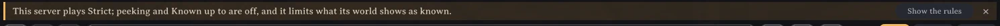
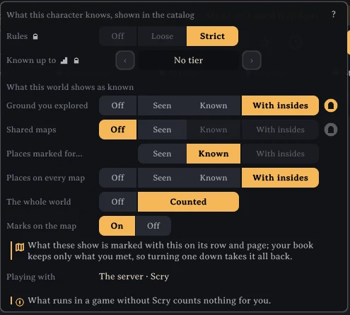

# Server settings

A server with Scry, a dedicated one or a game hosting, can set what the compendium allows in section *4 - World* of `BepInEx/config/isimp.Scry.cfg`. The server sends these to every player connected; while connected, the server's values win, each player's own choices kept beneath them for when they play elsewhere. Left as written on first start, every choice is each player's. On a dedicated server, change them with the server stopped, then start it again.

## The settings

`Rules` is the compendium's rules everyone plays by: `Off`, `Loose`, `Strict`, or `PlayersChoose` (the default), which leaves them to each player ([the rules](rules.md)).

`Peeking` (true by default) is whether players may peek, at the page shown until they go to another or at every page until the panel closes.

`KnownUpTo` (true by default) is whether players may raise *Known up to*, showing everything of the tiers below the bosses they beat as known.

`SeenReach` (10 by default) is how near, in metres, a creature in view counts as seen up close, its stars and what it carries kept for the compendium: as far as the game names a creature and marks its stars over it. Under *Strict* the stage shows a creature only with the stars and gear it was seen with so; 0 keeps none.

The rest cap how far each source of the world may show in the compendium's box; a player choosing above the cap gets the cap.

`ExploredUpTo`, for *Ground you explored*: `Off`, `Seen`, `Known` or `WithInsides` (the default). `MarkedUpTo`, for *Places marked for you*: `Off`, `Seen`, `Known` or `WithInsides` (the default).

`SharedMapsUpTo` and `OnEveryMapUpTo`, for *Shared maps* and *Places on every map*: `Off`, `Seen`, `Known` or `WithInsides` (the default).

`WholeWorldUpTo`, for *The whole world*: `Off` or `Counted` (the default).

Two more, in the section `[5 - Server]`, count only on the server and are never sent to players. `ReadTracesOnStart` (on by default) has the game running the world, a dedicated server or a host, read what was left inside the world's dungeons each time the world starts, a few milliseconds a frame, so rooms emptied before anyone's walk was kept count as walked on this server; off, they are read only when an admin types `/scry read traces`. `TakeWalks` (on by default) keeps the dungeon walks players send and tells them to everyone as walked on this server; off, the server keeps no one's walks, each player keeps their own, and the others see only what the traces show.

The server answers each player's asks about their ground (which places and dungeons lie in it) a few at once and then about one a minute, so a changed game cannot map the world by asking cell by cell; a player's own game never asks faster than that.

## Examples

For a group that wants to find everything itself: `Rules = Strict`, `Peeking = false`, `KnownUpTo = false`, `SharedMapsUpTo = Seen`, `OnEveryMapUpTo = Seen`, `WholeWorldUpTo = Off`.

For a relaxed group that shares what it finds: leave `Rules` at `PlayersChoose` and the caps at their defaults, so a map shared at a cartography table can show its dungeons with what anyone walked inside.

## What players see

On joining, a notice under the panel's header says once what the server sets, such as "This server plays Strict; peeking and Known up to are off.", with *Show the rules* opening the compendium's guide; it is told again only when the server's settings change. The compendium's box shows a rule or a level the server set locked, with a lock after its caption and a tip saying the server keeps it so; levels above a cap are dimmed. Players without Scry join and play as before.

More: https://github.com/isimp/Scry
