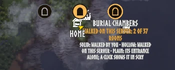

# Marks on the map, the server's records and traces

The marks of dungeons on Valheim's large map, the server's records of everyone's walks, and the traces left inside the world's dungeons.

Code: `src/Model/DungeonMaps.cs`, `src/Model/DungeonTraces.cs`, `src/Model/MapMarks.cs`, `src/Catalog/GroupMapsLink.cs`, `src/Preview/ExampleLayouts.cs`, `src/Model/WalkList.cs`, `src/MapMarkButtons.cs`, `src/Session.cs`.

See also: [this dungeon](this-dungeon.md), [network](../network.md), [server](../server.md); all notes in [the index](../index.md).

## Marks on the map

While Valheim's large map is open, each dungeon kept in the world played has a mark of Scry's, an accent disc with its kind's glyph in it, a tick in the glyph's place where every room of it was walked, by you alone or by you and others on this server together (`MarkLook.Whole`, end caps and dividers left out, `DungeonMaps.WalkedTogether` joining the server's record room by room where its rooms are yours), on its entrance, placed as the game places its pins (`Minimap.WorldToMapPoint`, `Minimap.MapPointToLocalGuiPos`; `MapMarks`), a pin's size scaled as the settings say, a pin placed there standing under it (`MapMarkButtons`). Each mark carries a glyph for the dungeon's kind, told by the location's prefab (`MarkGlyphs`): the Burial Chambers' doorway, the Sunken Crypt's portcullis, the Frost Caves' icy peak, the Infested Mine's gate, the Citadel's crown, Hildir's howl, flame and keyhole tower, and a plain door for a dungeon a mod adds; drawn from shapes in a 64-unit space as coverage (`MarkRaster`), filled for a mark walked by you and as the body's edge drawn inward for one walked on this server or an entrance alone, into pictures of 128 pixels kept per world (`MarkPictures`). The settings choose which marks show (walked by you, walked on this server, entrances alone), size them from half to twice a pin, their names growing with them, and put the marks of dungeons you walked on the minimap too, at its pins' size and without names; an entrance alone stands faint until the pointer rests on it. A place the game builds as a dungeon but whose rooms stand in the world itself, Hildir's Sealed Tower, is walked into rather than entered: its generator stands in the place, not some 5,000 m over it at the zone's interior spot (`DungeonPlan.LiesInside`, `DungeonKinds.InWorld`), so it is no dungeon lying inside, gets no entrance's mark, and is never asked of the server. Standing in it as the compendium counts it (`Location.GetLocation`) keeps a visit by where it stands, with its first and last day and no rooms (`DungeonMaps.Visited`, an `entrance` line with a `days` line after it, which an older Scry reads too), never listed to the server as a walk; it is marked as one you walked, filled, on the small map too, its words saying you were there with no rooms counted, and a click opens its page as it stands (`MarkLook.Visited`, `DungeonMapWords.VisitedLabel`). A visit from before this was kept shows once the place is stood in again, as nothing kept where it stands. Each mark is a picture on the layer of the pins' names, laid out as the game's pin is, so no name covers it. The pointer never reaches that layer through the game's event system, so the mark takes no clicks of its own: the pointer is read against it as the game's map and tips read it, with no camera, the map under it takes the click and its own click hands it to the mark, and a double-click there adds no pin (`MapMarkClick`, `MapMarkDoubleClick` on `Minimap.OnMapLeftClick` and `Minimap.OnMapDblClick`). A click closes the map and opens Scry on the dungeon's page, its map on the stage, at once where the catalog is read, else once it is, unless the panel is closed meanwhile (`Session.ShowEntry`, `PendingPage`); the game calls any press under a quarter second a click however far it moved (`Minimap.OnMapLeftUp`), so a mark takes one only where the pointer stayed within half a mark of where it was pressed, and a quick drag of the map let go over a mark stays the map's (`MapMarks.Clicked`).

The marks are placed in Scry's late update, after the game's map has moved that frame, so they keep to it as it is dragged, and no tip shows while the map is held. Its name and how far it was walked stand under it while the pointer rests on it, as the game names a pin: a copy of the game's own pin name (`Minimap.m_pinNamePrefab`), its text set by name as the game's TextMeshPro code sets it, larger than the game's pin names and boxed behind in a dark plate as its text draws a mark, so it reads on snow as on the sea (`DungeonMapWords.OnPlate`), and drawn last on the names' layer while the pointer rests on it, above every other name, as the game adds a pin's name above what stands there when the pin comes into view. The words of one you walked count the rooms others on this server walked with yours, whatever the compendium shows of its rooms, as how far a group walked a dungeon tells nothing of what is in it: "Walked whole on this server: all 9 rooms" or "Walked on this server: 7 of 9 rooms", then "5 of them by you" (`DungeonMapWords.TogetherLabel`); a hollow one walked whole by others is ticked in outline (`MarkLook.ServerWhole`). Where *Dungeon marks' names* on the settings card is *Always* (`DungeonMarkNamesAlways`), each mark's name alone stands under it at all times, in the game's own pin name style without a plate, and all its words while the pointer rests on it (`MapMarks.WordsOf`). What each look of mark means is told in the compendium's guide, the days walked on the dungeon's page. It is no pin of the game's: nothing is added to the player's pins, saved with the world or shared, and no rooms are drawn on the map. `DungeonMarksOnMap`, *Marks on the map* in the compendium's box, turns the marks off. With the map closed it costs one look at the map's mode a frame. A ground of the compendium's box whose pin is on marks besides, while its row shows anything, each dungeon lying in it (`DungeonMarks`, `DungeonsInGround`), in one of two looks (`MarkLook`): hollow, a dark disc ringed in the accent with the glyph in outline, where the row shows *With insides* and anyone on this server walked a room of it, its words saying how far (`DungeonMapWords.ServerLabel`); else by its entrance alone, a dark disc ringed faint with the glyph's outline faint, its words saying whether anyone on this server walked it (`DungeonMapWords.EntranceLabel`). One walked by you keeps its own mark, its words saying how far you walked it (`DungeonMapWords.MarkLabel`).

The game running the world looks through each location in the ground (`WorldDungeons.InGround`): for one placed, its zone's objects for a generator standing where the game counts a place as inside (`Character.InInterior`, above 3,000 m) with rooms saved, the one nearest the entrance, taking in the server's record of anyone's walks on it where its rooms are the same (`GroupMapsLink.RecordOf`); for one of a kind of dungeon lying inside holding no rooms yet, placed or not, its entrance alone, as the game knows where every location lies (`DungeonKinds`, from the places read: a plan of the game's dungeon kind, not a camp's; kept by `DungeonMaps.EntranceIdOf` on a line `entrance` of its own, which an older Scry passes over). It does so here where this game runs the world, else asked of a dedicated server's Scry (`Scry_DungeonsAsk`, `Scry_DungeonsAnswer`) with the ground packed as for the explored map and the kinds of dungeon named after it, which a server's older Scry leaves unread, answering with the dungeons whose rooms are kept alone; the answer is the maps' own text, so the server tells where they are only for a ground the player pinned or shows with insides. It is asked as a pin goes on and every ten minutes while it is on or the row shows *With insides*, as the ground grows, and held for the session. A server without Scry never answers.

A click on a hollow mark shows that dungeon's own rooms on the stage, those anyone on this server walked lit (from the server's records or the ground's answer, `ExampleLayouts`); a click on an entrance whose rooms the world keeps shows that dungeon's own rooms too, in the fog where nobody walked it; one whose area never loaded has no rooms anywhere yet, as the game lays a dungeon out the first time anyone comes near, so its page shows an example tagged as one, its note saying it stands in and why (`ExampleLayouts.StandInFor`).

## The server's records

Scry's copy on the world's server, a dedicated one or a game hosting, gathers the server's records, anyone's walks (`GroupMapsLink`): each client sends the record of the dungeon it walks in, at most every ten seconds, as it comes in, as a day in it begins and as it stands in a room new to its walk, and the server keeps one record a dungeon of its world, its rooms as the first player sent them, every room any player stood in and the earliest first and latest last day it was told, not who stood there (`DungeonMaps.Merge`), in `BepInEx/cache/isimp.Scry/maps-<world>.dat`, read and written as a character's maps are. Where the compendium is on and its floor is at or past a dungeon location's tier (`CompendiumView.BelowFloor`), its page asks for the records of that location at most once a minute, and the server sends them as they stand from their generators, no place of the world in them (`DungeonMap.FromGenerator`, `Quat.ToEuler`, `DungeonMaps.Only`); each joins its dungeon's line on the page, described above. The large map asks for the records of the locations its marks stand for as it opens, so each mark's words say how far anyone on this server walked it (`DungeonMapWords.ServerLabel`), the last days walked told on the dungeon's page. The fog then shows the rooms the character or anyone on this server walked, and peek the rest of the room list; a dungeon nobody walked has no record and is never sent.

`scry forget server maps` (also still `scry forget group maps`, as it was first called) forgets the server's records of the world: at once where the game is the server, else asked of the server, which does it for an admin alone (`ZNet.IsAdmin`), noting the game's day it did so on a line of its own (`DungeonMaps.NoteForgotten`, line `forgotten`). On joining, once the server's Scry said hello and the character's maps are read, a client lists its walks of the world to the server, a few bytes a dungeon: which, how many rooms walked and the last day (`WalkList`, `Scry_WalksList`); the server answers with those it lacks, has fewer rooms walked of or an older last day of, none last walked before the day its records were forgotten on, nor one of no known day after a forget (`WalkList.Wanted`, `Scry_WalksWanted`), and the client sends just those, twenty to a message, by the message a walk goes by. Of every walk a game sends, the server takes in only one of a location the world places where the walk's id says, and of that location, with the rooms its map holds, no more than 512 of them where the game's dungeons hold a few dozen and a fortress with its wall caps some 250 (`DungeonMaps.MostRooms`), and no day later than the world's today (`DungeonMaps.HeldBy`), so no game can light rooms of a place that is not there or grow the records without end. So walks made before the server kept them, or lost from it, come in, and a forget sticks; where this game runs the world it takes its own in itself. A dungeon walked again after a forget sends its whole map, the rooms walked before it too.

## Traces

What was left inside the world's dungeons tells that someone walked them, though not who, as the game keeps no maker of it (`ZDO.Save` keeps no owner): where this game runs the world, which holds every object of it, Scry reads it, a dungeon a frame once its prefab and its rooms' loaded on their own, so the host's frames are not held while they load: once the records are read, at each start, on a dedicated server and a game hosting the world alike, so a world counts the same whoever hosts it, and again on `scry read traces`, for an admin (`DungeonTraceReader`). A room's parts are made again as the game made them when the world was first built, its random parts rolled from the room's own place (`DungeonGenerator.PlaceRoom`, `DungeonTraces.RoomSeed`), the room's prefab set back after as the game sets it back; where a generator adds its own seed to the roll, only the parts no roll decides count. A pickup the game takes away on picking, a chest that goes once empty and is always filled, a rock mined or a thing broken, gone from where its room made it, is a trace of the room it was in (`DungeonTraces.Gone`); standing, a pickup picked, a chest holding fewer items than its filling ever gives, which for a dungeon chest gives each item once and two or three at the least, so one taken from though not emptied (`DungeonTraces.TakenFrom`), a door opened, of the room on its entrance side, and a spawn point woken, which wakes for anyone within 60 m and so tells only that someone was inside.

What moves or goes by itself is passed over: a loose item vanishes after an hour with nobody within 25 m, a part with a lifetime ends, a creature walks off. Every visit starts at the entrance, so the way to each room with a trace was walked too: the way needing the fewest rooms nobody is known to have walked, of two as good the one through the room placed first (`DungeonTraces.Uncovered`), worked out again as a walk comes in, so a walk round the other side of a loop takes a guess on this side back. After the world's records were forgotten, only traces of that day or later count, and only a pickup that grows back keeps a day, so a forget sticks. The rooms they uncover are kept in the record apart from the rooms walked, on a line of their own an older Scry passes over (`DungeonMaps.SetTraced`), so a walk sent counts against the rooms walked alone; the server answers them as walked, telling those of traces alone apart, and a client takes each record of an answer in place of the one it held (`DungeonMaps.Replace`). What was read stays: the record keeps the rooms that held traces and those doors opened lead on from, and each reading adds to them, of each kind as much as was ever read at once (`DungeonTraces.Keep`), as a mod resetting dungeons takes the traces away (Venture Location Reset deletes every object inside one and has its generator build it again from its own seed, chests filled and pots whole, by default 30 days after it was last visited); a dungeon made again of other rooms than its record holds, as a mod raising their number may make it, is passed over (`DungeonMap.SameRooms`).

A dedicated server's log says after each reading how many dungeons held traces and how many chests the rooms read were made with, stand, were filled, were taken from and are gone. The record's line on a page and its mark on the map say how many rooms came of traces, its hover what was left inside (`DungeonMapWords.TraceTip`). The traces tell nothing of who: they count as walked on this server, never by you. A room with nothing in it to leave a trace is uncovered only on the way to one; a stray hit or a door opened from its far side can shift one room. Only players running Scry add to a record, and a server without Scry never answers.
